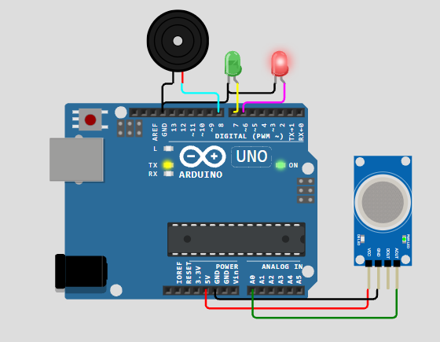

# Smoke and Gas Detector Alarm System (MQ2)

An Arduino-based safety monitoring system that detects smoke and flammable gases (LPG, propane, methane, hydrogen) using an **MQ2 sensor**. Includes two progressive implementations:
1. **v1 (Basic):** Visual (Red/Green LEDs) and audible (Buzzer) alert system.
2. **v2 (Upgraded):** Adds a **16x2 I2C LCD** for real-time gas concentration readout and status display.

---

## Bill of Materials (BOM)

| Component | Qty | Notes | Version |
| :--- | :---: | :--- | :---: |
| Arduino Uno | 1 | Main microcontroller | v1 & v2 |
| MQ2 Gas/Smoke Sensor | 1 | Analog output (`A0`) | v1 & v2 |
| Red LED | 1 | Danger indicator | v1 & v2 |
| Green LED | 1 | Safe indicator | v1 & v2 |
| Active Buzzer | 1 | 5V audible alarm | v1 & v2 |
| 220Ω Resistors | 2 | Current limiting for LEDs | v1 & v2 |
| 16x2 LCD with I2C Module | 1 | Address `0x27` | v2 only |
| Breadboard & Jumper Wires | - | Prototyping | v1 & v2 |

---

## Pin Connections

## Live Simulation Demo
https://github.com/aakash-ahirwar/smoke-gas-detector-mq2/raw/main/media/simulation_demo.mp4

### Common Wiring (v1 & v2)
| Component Pin | Arduino Uno Pin | Notes |
| :--- | :---: | :--- |
| MQ2 `A0` | `A0` | Analog gas reading |
| MQ2 `VCC` | `5V` | Power |
| MQ2 `GND` | `GND` | Ground |
| Red LED (+) | `D6` | Connect via 220Ω resistor |
| Green LED (+) | `D7` | Connect via 220Ω resistor |
| Buzzer (+) | `D8` | Active buzzer |

### Additional Wiring for v2 (16x2 I2C LCD)
| LCD I2C Pin | Arduino Uno Pin |
| :--- | :---: |
| `SDA` | `A4` |
| `SCL` | `A5` |
| `VCC` | `5V` |
| `GND` | `GND` |

---

## Getting Started

1. **Install Required Library (for v2):**
   * Open Arduino IDE → **Sketch → Include Library → Manage Libraries...**
   * Search for **`LiquidCrystal I2C`** (by Frank de Brabander) and click **Install**.
2. **Upload Code:**
   * Open `code/v1_basic_led_buzzer/v1_basic_led_buzzer.ino` or `code/v2_with_16x2_i2c_lcd/v2_with_16x2_i2c_lcd.ino`.
   * Select **Board: Arduino Uno** and your active **COM Port**, then click **Upload**.
3. **Calibration Note:**
   * Allow the MQ2 sensor 1–2 minutes to preheat on first power-up. Adjust `const int threshold = 300;` based on your Serial Monitor baseline readings.

---

## Author
**Aakash Ahirwar** — AI, Robotics & Computer Science Educator